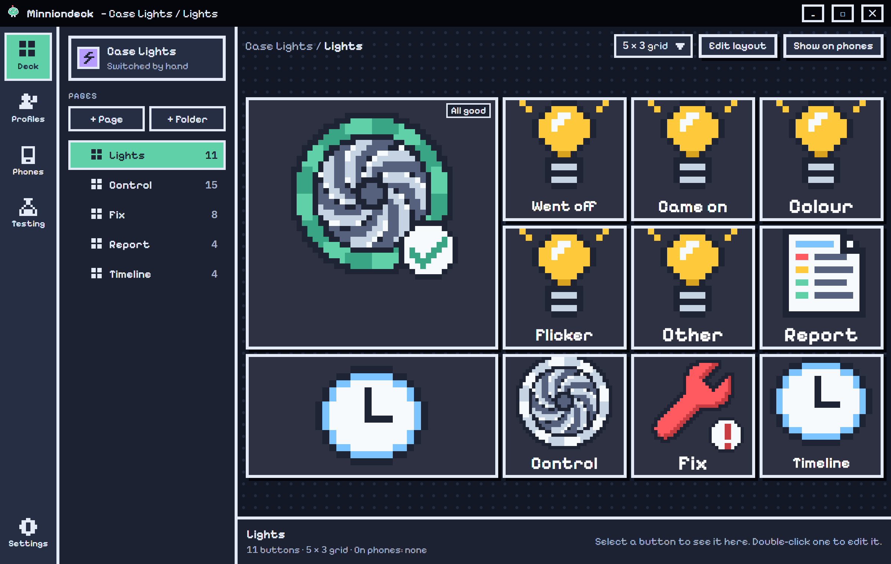
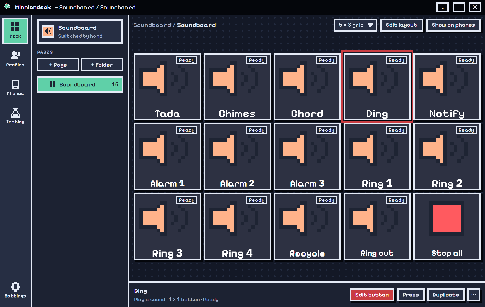
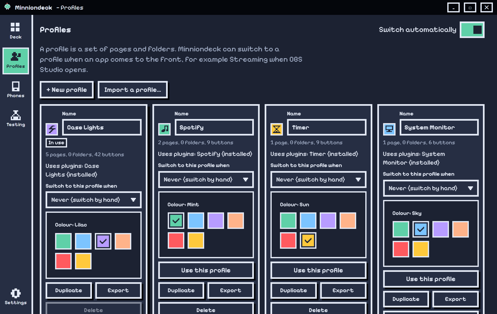

<div align="center">


# Minniondeck

**Big square buttons and live screens for your PC, run from an Android phone.**
Press a button on the phone, and something happens on your PC, in your flight sim, or in the app in front.
Built for **Microsoft Flight Simulator 2024** first, with plugins for everything else.


**[Website](https://minnnion.github.io)** · **[MinnionDeck Marketplace](https://github.com/minnnion/Minnion-Marketplace)**



</div>

---

## What it is

Minniondeck is a Stream-Deck-style system made of three parts:

| Part | What it does |
|---|---|
| **Desktop app** (this repo) | The hub. Holds your profiles, buttons, pictures and plugins, runs actions on the PC, and talks to your phones. |
| **Phone app** (Android, separate repo) | Shows the active profile as a deck of big square buttons and live screens. Presses go straight to the PC over Wi-Fi. |
| **Plugins** (separate repos) | Add whole worlds of buttons: MSFS 2024, Spotify, case lights, speech and more. |

The phone is the main device. Lay your deck out once on the PC, and the phone follows it, page for page.

## Features

### Deck and button designer
- **Pages, folders and profiles.** Grid layouts, buttons in three sizes, Go to page and Back, and an inspector for the selected button.
- **Pixel-art button designer.** Layers, button states (on and off and more), press animations, **1,036 pixel icons** and **3,466 app and game logos**, and live text. The GIF maker and image maker are on the [website](https://minnnion.github.io).
- **Actions.** Keys, typing, mouse, programs (drop one on the Edit window), websites, volume and media, waits, sequences, knobs, live maps and plugin screens.
- **Automatic profile switching.** A profile can switch on by itself when an app such as OBS Studio or Spotify comes to the front.
- **Share profiles.** Export and import `.mdprofile` files, with an "Allow imported buttons?" check before anything runs.

<div align="center">

</div>

### Phones
- Pair with a matching number over Wi-Fi. The PC keeps only a hash of each phone's token, and phones pin the PC's certificate fingerprint.
- The phone follows the PC's page, stays awake, vibrates on press, and gets everything back when it reconnects.
- Go to page and Back turn the phone's page at once.

### Profiles
<div align="center">

</div>

### Plugins
Plugins are signed `.mdplugin` files written with the Rust **plugin kit** in [`plugin-kit/`](plugin-kit).

- Each plugin gets its own settings form. Passwords are encrypted with Windows DPAPI and are never sent back to the window.
- Plugins can set a button's state, title, icon and live data (maps, screens). Phones get the same.
- Install, update and reload without restarting the app. Trusted authors and a developer mode are built in.
- A plugin can ask the app to speak. The app runs one local speech model (Phonon 31M English, Apache 2.0), so nothing leaves your PC.

| Plugin | What it does |
|---|---|
| **MSFS 2024 Deck** | Fenix A320 controls, live map, BeyondATC, GSX Pro, SimBrief |
| **Cockpit Camera** | Head motion and smart views for MSFS 2024, using the official Camera API |
| **Speech + Voices** | Offline text to speech with 37 English voices |
| **Case Lights** | MSI board RGB: colours, scenes, screen sync |
| **Spotify Control** | Play, skip, volume and a now-playing tile with the real cover |
| **Timer** | Countdowns, a stopwatch, a focus timer (Pomodoro) and a clock, live on the key |
| **System Monitor** | CPU, memory, disk space and network speed, read straight from Windows |
| **Soundboard** | Play MP3, WAV, WMA or M4A files from your keys, each at its own volume |
| **Weather** | The weather now for any town, with a matching picture (data by Open-Meteo.com) |

> Plugins are not part of this repository. Install them from the **[Minnion Marketplace](https://minnnion.github.io/#marketplace)**: press **Install** and Minniondeck downloads, checks and loads the plugin.

### Built for flight simulation
The MSFS 2024 plugin turns the phone into a cockpit panel:

- **Fenix A320:** every control as a button by panel, lit push buttons, switches, knobs with push and pull, and live values (FCU, BARO and more).
- **Live map:** your aircraft, other traffic, the SimBrief route, the ATC taxi route with hold-short bars, and airport diagrams (72,662 airports).
- **BeyondATC, GSX Pro and SimBrief:** radio messages, services, pushback direction, and the OFP screen. All read through the links those tools offer. Nothing in them is changed.
- **Cockpit camera:** head motion for engines, ground, air and touchdown, and smart views you reach by holding the middle mouse button.

## Download

**[Download Minniondeck 0.1.0 for Windows](https://github.com/minnnion/MinnionDeck/releases/latest)** from Releases. It's free, with no account and no licence key.

| File | For |
|---|---|
| `Minniondeck_0.1.0_x64-setup.exe` | Most people. **Minniondeck Setup**: installs for you, with no admin prompt. |
| `Minniondeck_0.1.0_x64_en-US.msi` | Silent or managed installs, for everyone on the PC. |

**Minniondeck Setup** asks what you'll use Minniondeck for, shows the plugins from the marketplace that go with it, and installs the app and the plugins you keep ticked. Each plugin is checked against its SHA-256 before it's added. It adds Start-menu and desktop shortcuts, opens `.mdprofile` files in Minniondeck, and has a normal uninstaller in Windows' Installed apps.

**Windows may say "Windows protected your PC"**, because the installer isn't code-signed yet. Press **More info**, then **Run anyway**.

Then add plugins from the **[Minnion Marketplace](https://minnnion.github.io/#marketplace)**, and get the phone app from the [website](https://minnnion.github.io/#download).

**Requirements:** Windows 10 or 11 (64-bit) and an Android phone on the same Wi-Fi.

Minniondeck is only supported when installed from Releases, so it stays up to date and its plugins keep working.

### Coming next
Streaming, Games and Work in the setup, once their plugins are in the marketplace. Today it sets up General.

## Project layout

```
src/            Front end: plain JavaScript and CSS, in the app's own pixel style
src-tauri/      Rust backend: actions, phones, plugins, storage, speech, maps
plugin-kit/     Rust crate plugins are built against
public/         Static files the app loads (airport data, backend bridge)
docs/           Screenshots used in this README
```

## Security

Minniondeck is built to be safe to share profiles and plugins with:

- A **content security policy** stops imported data from running script, and every value from a file is checked before it reaches the page.
- Imported buttons ask first ("Allow imported buttons?"), and a phone press goes through the same question.
- Phone pairing uses 6-digit codes and 256-bit tokens from the OS random generator, with lockout after repeated tries and single-use codes.
- Plugin passwords are encrypted with Windows DPAPI.

To report a security problem, open a private security advisory on GitHub.

## Roadmap

- [x] Deck, profiles, phones and the button designer
- [x] Plugin system, with encrypted settings
- [x] Local speech engine
- [x] MSFS 2024 plugin: Fenix A320, live map, BeyondATC, GSX, SimBrief
- [x] Cockpit camera: head motion and smart views
- [x] Minniondeck Setup (0.1.0): asks what you'll use it for, and installs the plugins that fit
- [x] Minnion Marketplace with official plugins: Spotify, Timer, System Monitor, Soundboard and Weather
- [ ] Streaming, Games and Work in the setup
- [ ] Community plugins in the marketplace
- [ ] More languages

## Feedback

Bug reports and ideas are welcome as GitHub issues. The code is published so you can read it and see how it works. It is not accepting outside code changes.

## License

**Source-available, all rights reserved.** © 2026 minnnion. You may read the code and use the official release for your own use. You may not copy, rebuild, modify, redistribute or publish your own version of Minniondeck. See [LICENSE](LICENSE) for the exact terms.

Minniondeck is not affiliated with Microsoft, Asobo, Fenix Simulations, BeyondATC, FSDreamTeam, Spotify or any other product named here. All names and logos belong to their owners.
