<div align="center">

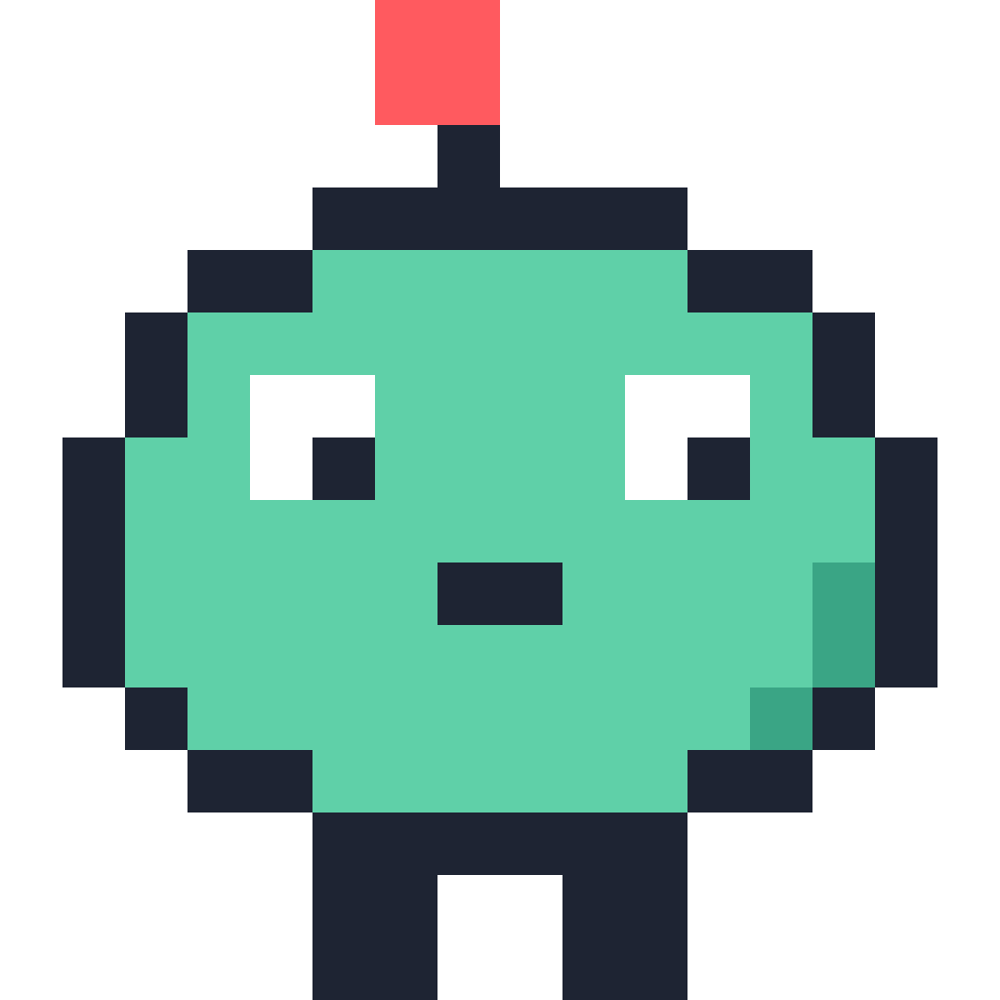

# MinnionDeck

**A Stream Deck for your Windows PC, with no hardware to buy.**
Big square buttons for apps, keys, sounds, timers, weather, PC lights and more, on your screen and on any phone.

[](https://github.com/minnnion/MinnionDeck/releases/latest)


**[Download](https://github.com/minnnion/MinnionDeck/releases/latest)** · **[Website](https://minnnion.github.io)** · **[Features](#features)** · **[How it works](#how-it-works)**

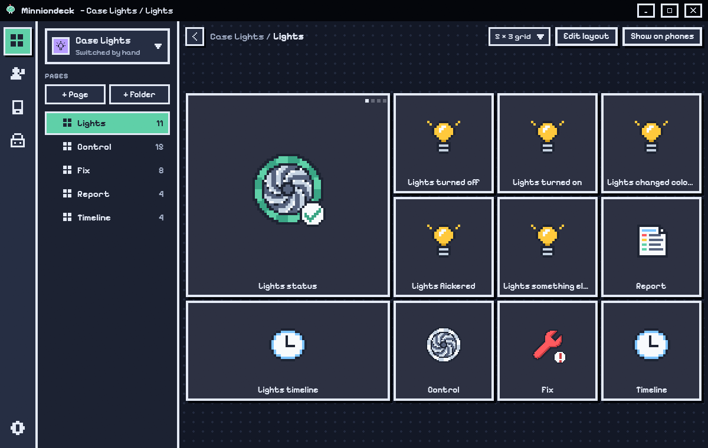

</div>

---

## Why MinnionDeck

Streamers, gamers and anyone who does the same things on a PC over and over want **one press for each job**. A hardware deck is one way to do that, but it costs money, takes desk space and only works where it's plugged in.

MinnionDeck gives you the same thing in software:

- **No hardware.** Your PC screen is the deck, and so is any phone or tablet you already own.
- **Nothing to install on the phone.** Scan a QR code, press Allow on the PC, and your buttons are on the phone.
- **Made to look good.** A crisp pixel-art style, with your own pictures and GIFs if you prefer.
- **Free plugins.** A soundboard, timers, weather, a live system monitor, PC case lights, music and more, each with a ready-made profile.
- **Your data stays yours.** Everything lives in one folder you choose, encrypted with a key made for your install.

## Who it's for

| | |
|---|---|
| **Streamers** | Sound effects, scene keys and timers, all on a phone beside the camera. |
| **Gamers** | Key combinations and macros, a soundboard, and CPU, GPU and memory at a glance while you play. |
| **Everyday work** | Open apps and websites, type text you use often, mute, change volume, run key combinations. |
| **Home office and desk setups** | Change your PC case lights, keep an eye on CPU, GPU and memory, start a focus timer. |

## Features

### A deck you design

- **Profiles, pages and folders.** Grids from small to large, buttons in several sizes, and Go to page / Back buttons.
- **A button for anything.** Press keys, type text, click the mouse, open a program or a website, change the volume, control media, and every action plugins add. One button can run several steps in a row.
- **Looks that change.** Each button can have several looks (on and off, playing and paused), with pixel icons, app logos, your own pictures and GIFs, and press animations.
- **1,036 pixel icons and 3,466 app and brand logos** built in.
- **Light and dark.** The whole app follows either theme.

<div align="center">
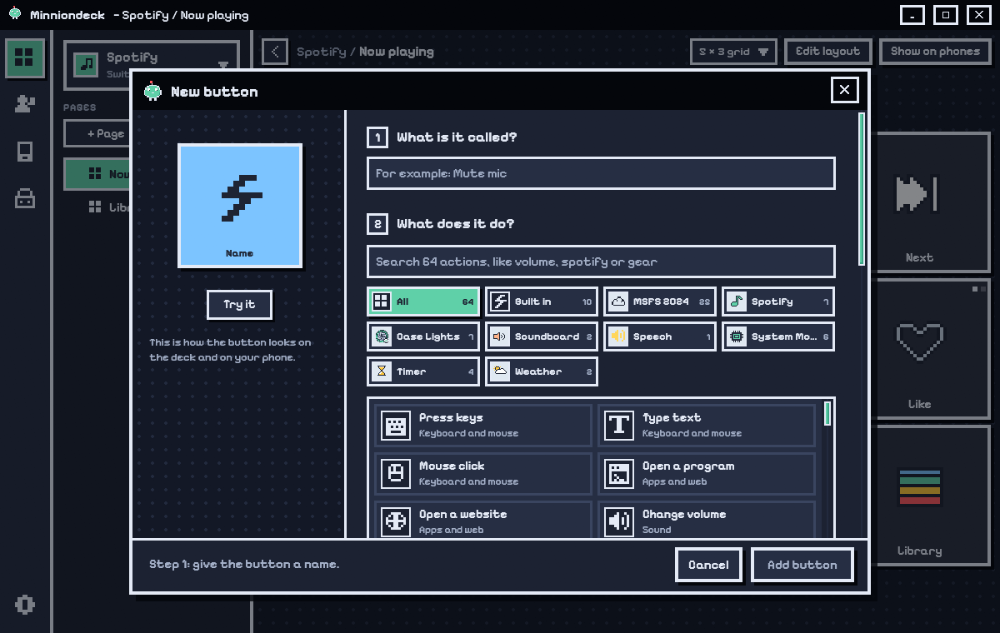
<br><sub>Making a button: pick what it does, fill in the details, and give it a look for each state (here a countdown: Stopped and Running).</sub>
</div>

### Decks for everything

<table>
<tr>
<td align="center" width="50%">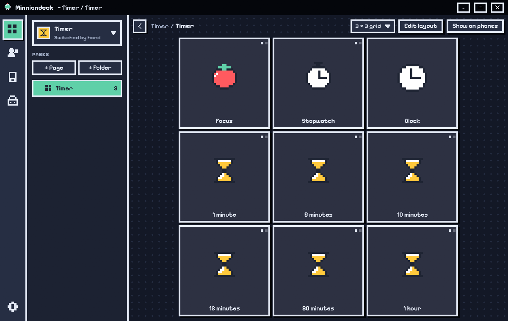<br><sub><b>Timer</b>: focus, stopwatch, clock and one-press countdowns</sub></td>
<td align="center" width="50%">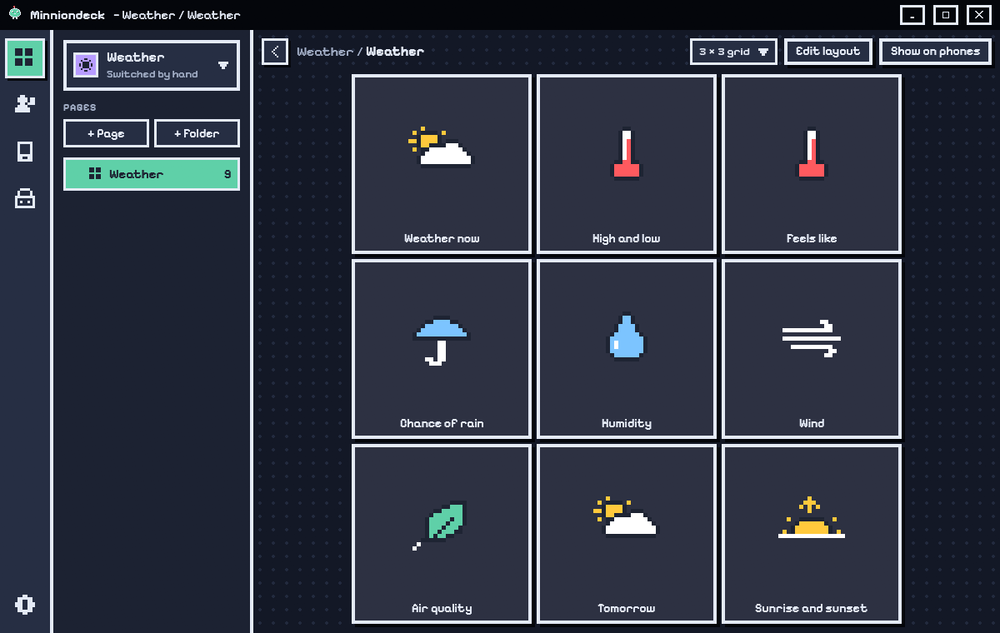<br><sub><b>Weather</b>: now, high and low, rain, wind, air quality</sub></td>
</tr>
<tr>
<td align="center" width="50%">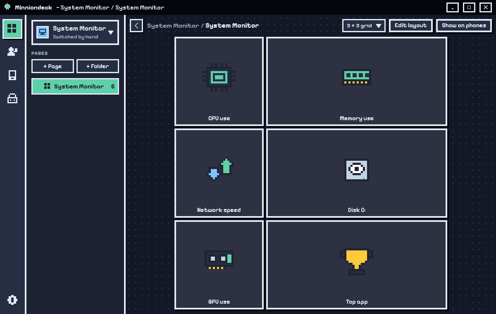<br><sub><b>System Monitor</b>: CPU, GPU, memory, disk and network, live</sub></td>
<td align="center" width="50%">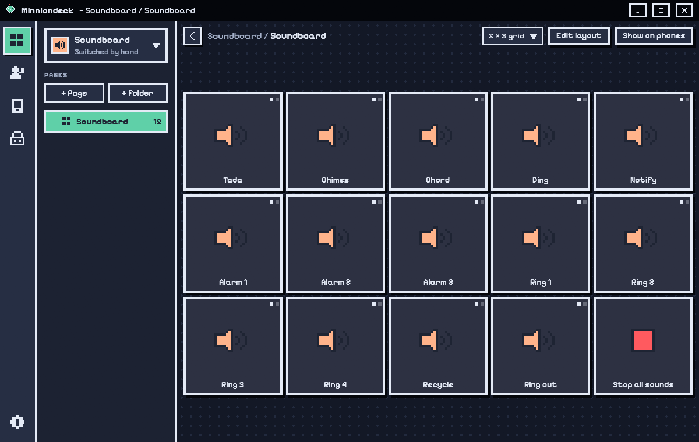<br><sub><b>Soundboard</b>: a sound on every key, and one to stop them all</sub></td>
</tr>
</table>

### Profiles that switch by themselves

Keep a profile for each thing you do. Turn on **Switch automatically** and MinnionDeck changes profile when an app such as your game, browser or music player comes to the front. Export a profile as a `.mdprofile` file to share it; double-click one to add it.

<div align="center">
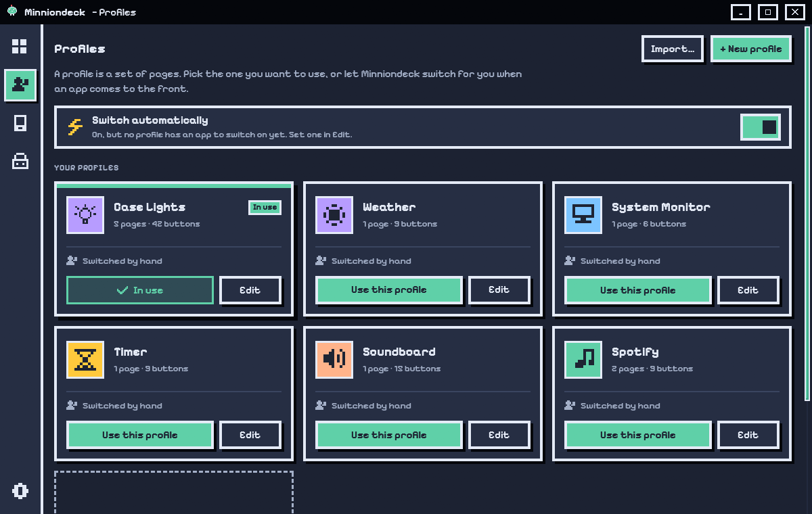
</div>

### Your phone is a deck

Open the **Phones** page, scan the QR code with your phone's camera and open the link. Press **Allow** on the PC and the phone shows your deck, page for page, with buttons sized to fit its screen in portrait or landscape. It works on Android and iPhone, over your home Wi-Fi, with nothing to install.

- Pairing uses a 6-digit code you confirm on the PC, and each phone gets its own key.
- Phones follow the page the PC is on, and a press on the phone runs on the PC right away.
- Add it to your home screen and it opens full screen, like an app.

<div align="center">
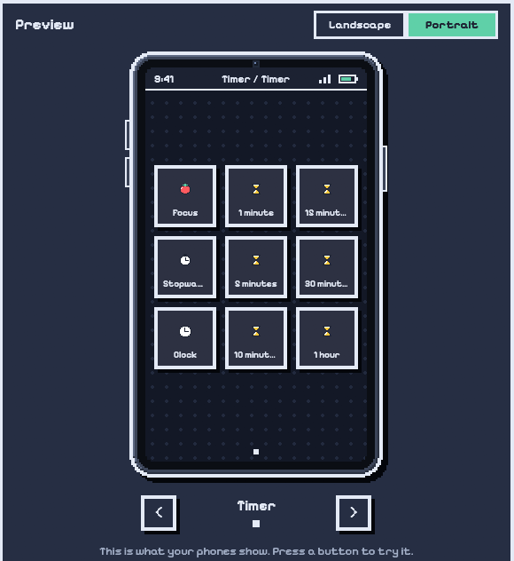
</div>

### Plugins from the Marketplace

Plugins add whole sets of buttons. Install them from the **Marketplace** page inside the app (open one to see what it adds and what's new), or tick them in the setup. Each one comes with a ready-made profile, and every download is checked against its SHA-256 before it installs.

| Plugin | What it adds |
|---|---|
| **Case Lights** | Finds out why your PC's case lights act up, and sets them for you. |
| **System Monitor** | CPU, GPU, memory, disk, network and the busiest app, live. |
| **Timer** | Clock, countdown, stopwatch and focus timer. |
| **Weather** | Live weather for your town on your buttons. |
| **Soundboard** | Play sound files from your buttons. |
| **Speech** | Reads text aloud with natural voices, on your PC. |
| **Spotify** | Play or pause, skip, like, volume and what's playing. |

<div align="center">
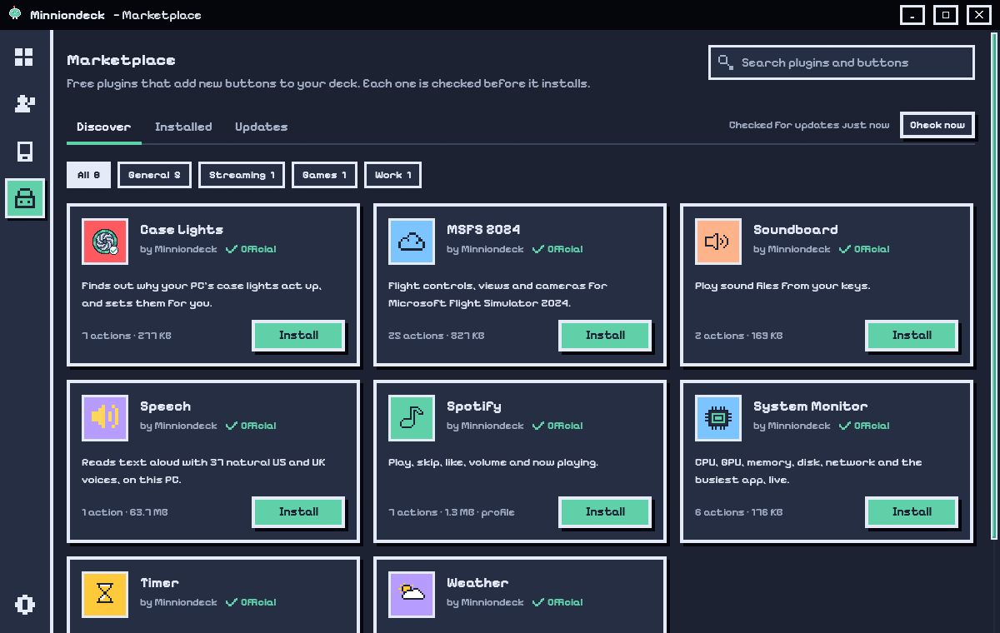
</div>

### Made to live on your PC

- **Tray icon.** Close the window and MinnionDeck keeps running in the tray, so your buttons and phones still work.
- **Start with Windows**, straight into the tray.
- **Backups.** A copy of your library is kept automatically each time it starts and before an import; restore one from Settings, or back up now.
- **Updates.** The app tells you when a new version is out and installs it for you.

<div align="center">
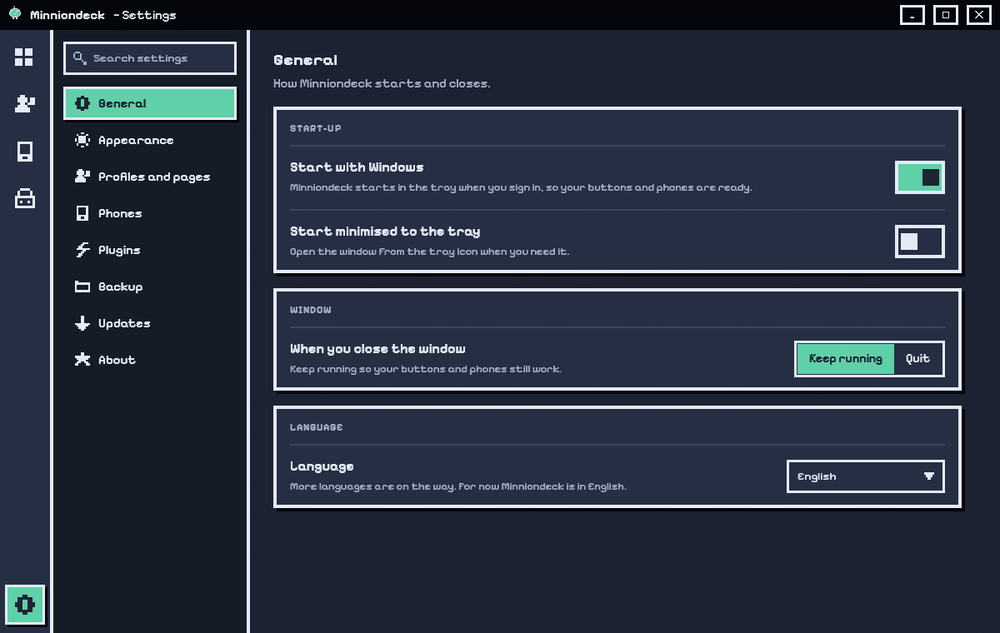
</div>

## Download and install

1. Download **`Minniondeck_<version>_x64-setup.exe`** from [Releases](https://github.com/minnnion/MinnionDeck/releases/latest).
2. Run it. Pick what you'll use it for and the plugins you want.
3. Choose where it goes. The app and **everything it keeps** (profiles, pictures, backups, plugins, settings) live together in that one folder.
4. Finish, and pair your phone from the **Phones** page.

No admin rights are needed. To remove it, use **Installed apps** in Windows. Your data stays unless you tick **Also delete my data**.

**Needs:** Windows 10 or 11, 64-bit. For phones: a phone or tablet on the same Wi-Fi as the PC.

## How it works

```
  Phone or tablet  ──Wi-Fi──▶  MinnionDeck on your PC  ──▶  keys, apps, volume, media
   (a web page)                  │                           and plugin actions
                                 ├── Profiles, pages, buttons
                                 ├── Plugins (from the Marketplace)
                                 └── One folder: app + all your data, encrypted
```

- **One folder.** `Minniondeck.exe` and all its data sit side by side in the folder you chose, so the whole install can be backed up or moved by copying that folder.
- **Encrypted data.** Your saves, pictures and backups are sealed with AES-256-GCM using a key made for your install the first time it runs (`data.key`). Keep it with your data: without it, the data can't be opened.
- **Phones** load a page the PC serves on your Wi-Fi. Nothing is sent to the internet.
- **Plugins** run in a separate helper process, so a plugin that stops can't take the app down with it.

## Built with

- **[Rust](https://www.rust-lang.org/)**: the whole app is native Rust, with no browser engine inside.
- **[egui](https://github.com/emilk/egui)**: the window and every screen, drawn pixel-for-pixel.
- **[Pixelify Sans](https://fonts.google.com/specimen/Pixelify+Sans)**: the pixel font.

The source is here to read. MinnionDeck is meant to be installed with the official setup from [Releases](https://github.com/minnnion/MinnionDeck/releases), which brings the app, its Windows entries, your chosen plugins and their profiles.

<div align="center">
<br>
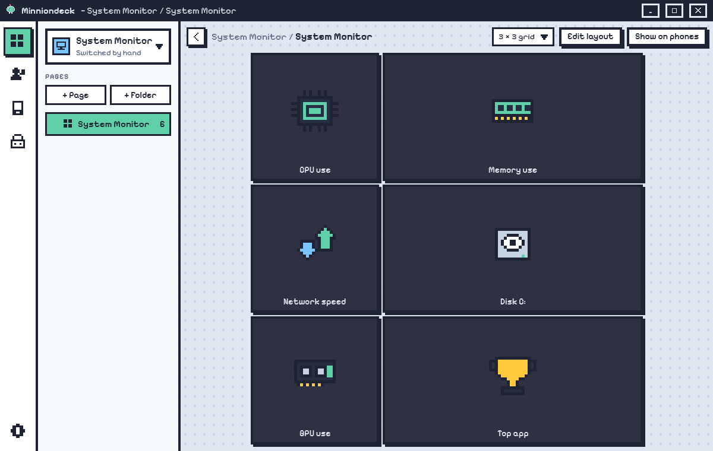
<br><br>
<sub>Made by <a href="https://github.com/minnnion">minnnion</a> · <a href="https://minnnion.github.io">minnnion.github.io</a></sub>
</div>
